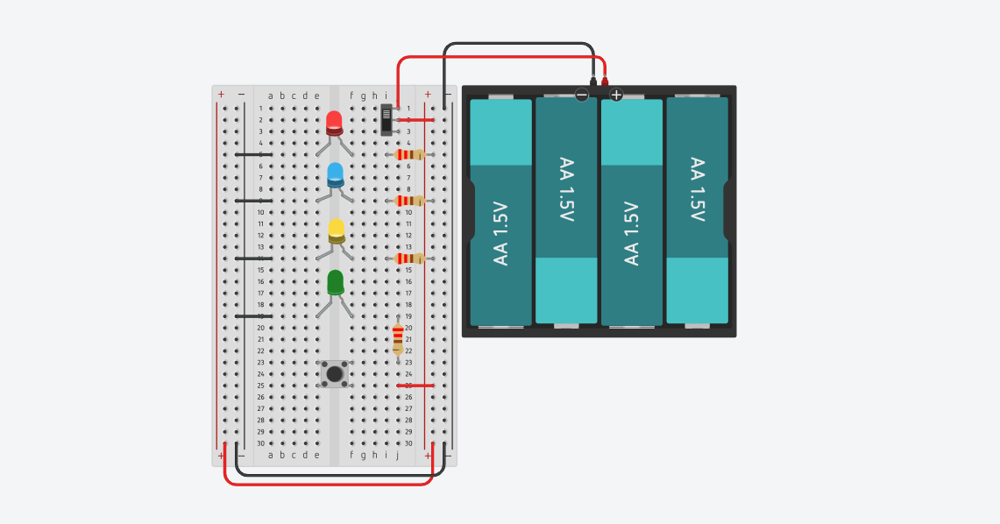

# multi-led-breadboard-circuit
# Multi-LED Breadboard Circuit with Push-Button Control

A DC electronics circuit built to demonstrate direct current routing, parallel load configuration, current limiting, and manual push-button control.

## How It Works

* **Power Source & Supply Voltage:** Powered by a 4 × 1.5V AA battery pack connected in series, delivering a total direct current (DC) supply voltage of **6V** ($4 \times 1.5\text{V} = 6.0\text{V}$) across the breadboard's power rails.
* **Power Rail Distribution:** Jumper wires bridge the top power rails to the bottom power rails to supply continuous positive ($+V$) and ground (GND) connections across the entire breadboard.
* **Current-Limiting Resistors:** Dedicated resistors are wired in series with each LED branch (red, blue, yellow, green). This controls the forward current flowing through the light-emitting diodes to prevent overcurrent damage.
* **Switch Control Mechanism:** A tactile push-button switch is wired into the main current path. Depressing the push-button completes the circuit to ground, allowing current to flow simultaneously through all four LED branches to illuminate them.

## Hardware & Components Used

* **Power Supply:** 4 × 1.5V AA Battery Pack (6V total output)
* **Prototyping Board:** Full-size Solderless Breadboard
* **Indicators:** 4 × Light Emitting Diodes (Red, Blue, Yellow, Green)
* **Passive Components:** 4 × Current-Limiting Resistors
* **Input Switch:** 1 × Tactile Push-Button Switch
* **Interconnects:** Breadboard Jumper Wires

## Key Technical Learnings
* Demonstrates how parallel circuit branches operate from a shared voltage source.
* Explores basic circuit protection using current-limiting resistors.
* Implements momentary switch input logic in hardware.
